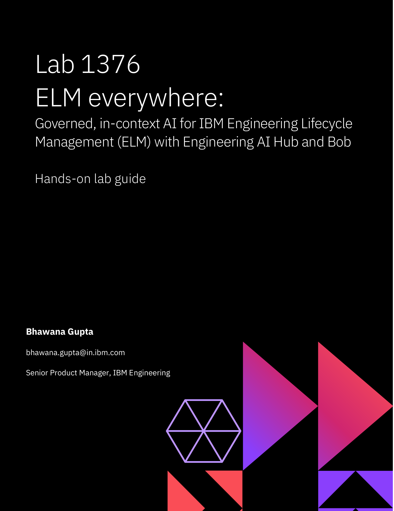
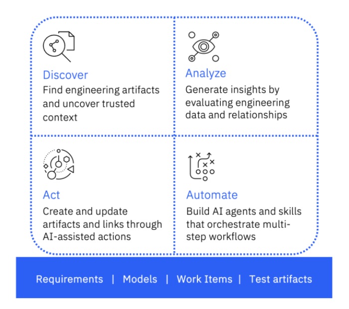
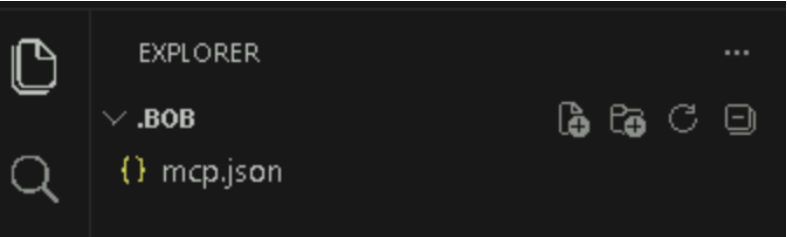
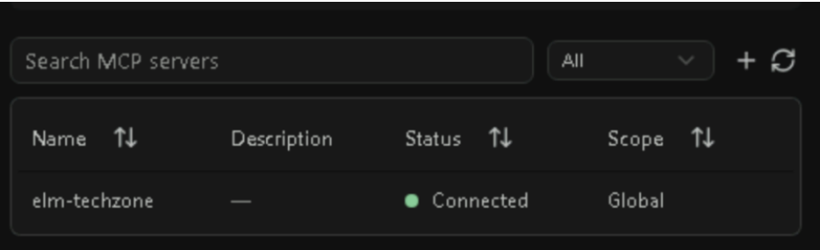
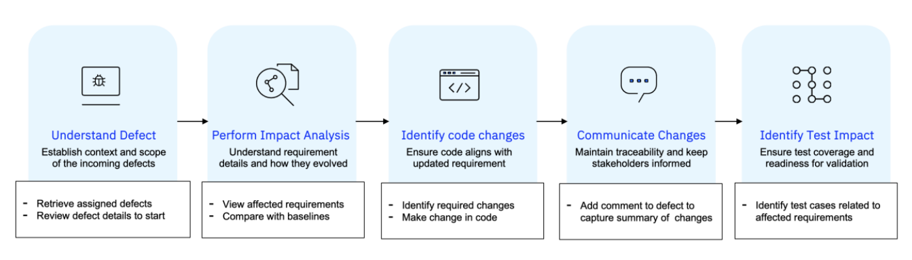
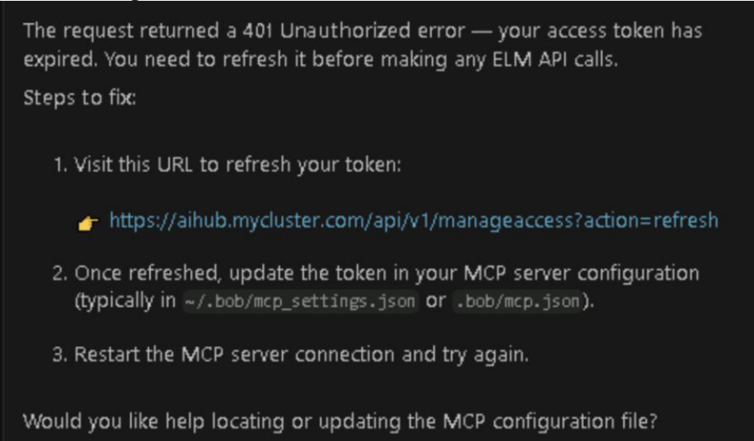
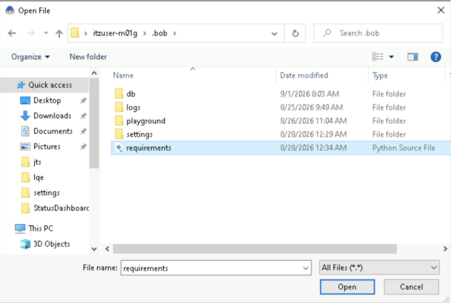
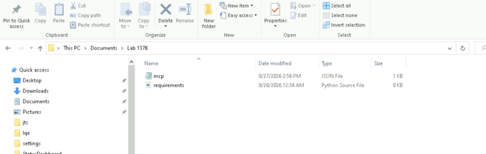
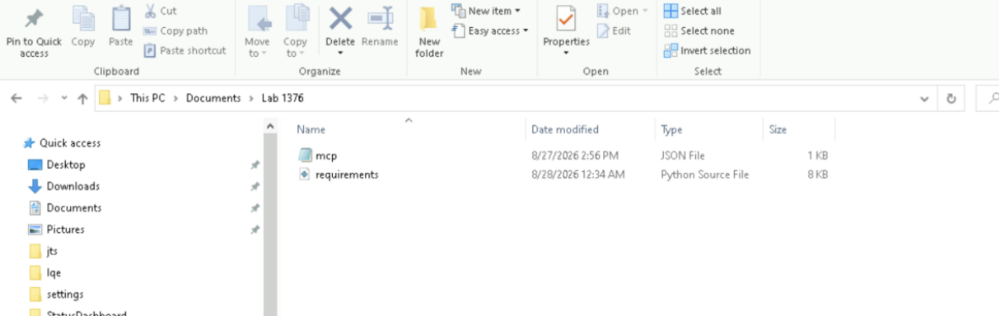

# Lab 1376 — ELM everywhere

**Governed, in-context AI for IBM Engineering Lifecycle Management (ELM) with Engineering AI Hub and Bob**

Hands-on lab guide · IBM TechXchange 2026

Bhawana Gupta, Senior Product Manager, IBM Engineering



**🌐 Lab website:** [brettscharm.github.io/lab-1376-elm-everywhere](https://brettscharm.github.io/lab-1376-elm-everywhere/) · **📄 Original PDF:** [Lab-1376-ELM-everywhere.pdf](Lab-1376-ELM-everywhere.pdf)

> **How to use this page:** every prompt you send to Bob is in a grey box. Hover over the box and click the **copy** icon in its top-right corner, then paste into Bob.

---

## Table of contents

1. [Introduction](#1-introduction)
   - [1.1 About IBM Engineering AI Hub](#11-about-ibm-engineering-ai-hub)
   - [1.2 About this hands-on lab](#12-about-this-hands-on-lab)
2. [Getting started](#2-getting-started)
3. [Scenario 1: Investigate and fix a defect](#3-scenario-1-investigate-and-fix-a-defect)
4. [Scenario 2: JKE Banking sprint health, risks, and dependency assessment](#4-scenario-2-jke-banking-sprint-health-risks-and-dependency-assessment)
5. [Scenario 3: ACC release readiness and safety certification assessment](#5-scenario-3-acc-release-readiness-and-safety-certification-assessment)
6. [Scenario 4: HSR environmental compliance and regulatory readiness assessment](#6-scenario-4-hsr-environmental-compliance-and-regulatory-readiness-assessment)
7. [Additional hands-on exercises](#7-additional-hands-on-exercises)
8. [Getting help and troubleshooting](#8-getting-help-and-troubleshooting)
9. [Learn more](#9-learn-more)
- [Notices and disclaimers](#notices-and-disclaimers)

---

## 1 Introduction

### 1.1 About IBM Engineering AI Hub

IBM Engineering AI Hub is a trusted, governed, agentic AI platform built specifically for IBM Engineering Lifecycle Management (ELM). It makes engineering knowledge AI-ready by grounding AI in trusted engineering data and lifecycle context while operating within established enterprise controls.

Engineering teams work with critical information across requirements, work items, models, tests, configurations, and lifecycle relationships. For AI to provide useful engineering assistance, it needs access to this information in its engineering context, rather than relying only on generic models or isolated documents. Engineering AI Hub provides this foundation by connecting AI capabilities with trusted engineering knowledge. It is designed to:

- Enable AI-driven engineering across the enterprise.
- Transform engineering data into actionable intelligence.
- Connect teams and processes across the engineering lifecycle.
- Provide a foundation for scaling AI adoption with confidence.
- Keep AI grounded in trusted engineering data and lifecycle context.

A key capability of Engineering AI Hub is its support for Model Context Protocol (MCP) tools. MCP tools provide standardized interfaces that allow AI assistants and agents to interact with trusted ELM data using natural language. They surface engineering artifacts such as requirements, work items, models, and test assets, together with the lifecycle context and relationships that connect them. This means an AI assistant can do more than retrieve an individual artifact. It can access the engineering context needed to understand how artifacts relate across the lifecycle, for example, how a requirement relates to a work item or test. MCP tools provide a governed and reusable foundation for AI-assisted engineering workflows. They build on existing ELM authentication, permissions, and access controls, so organizations do not need to establish a separate security and governance model for AI interactions.

The MCP capabilities used in this lab will cover four broad categories:



### 1.2 About this hands-on lab

This hands-on lab demonstrates how Engineering AI Hub MCP tools make trusted ELM data and lifecycle context available to AI assistants and agents, enabling engineers to interact with engineering information using natural language.

In this lab, you will use IBM Bob as the MCP-compatible AI assistant. However, the MCP tools are not specific to Bob. You can use any AI assistant, agent, or AI application that supports MCP and is configured to connect to Engineering AI Hub MCP tools.

Using Bob, you will work with sample ELM data across multiple project areas.

The lab has four guided scenarios in which you will investigate a defect, review health of a sprint, investigate the readiness of a release for safety certification and compliance.

You will then use the additional tasks to explore different ways of interacting with ELM data across the four sample project areas.

By the end of this lab, you will be able to:

1. Understand how Engineering AI Hub MCP makes governed ELM information available to AI assistants such as Bob.
2. Discover ELM-native artifacts, including requirements, work items, test artifacts, and engineering context using natural language.
3. Analyze engineering information across artifacts and configurations.
4. Use lifecycle relationships to trace information across requirements, work items, and other engineering artifacts.
5. Use engineering context to identify inconsistencies between requirements and implementation.
6. Perform governed actions using MCP tools.
7. Understand how MCP enables a connected engineering workflow across multiple ELM products without requiring users to manually navigate each product interface.

---

## 2 Getting started

Before beginning the lab, ensure that:

1. You give the servers 20 minutes to start. You should refresh the dashboard to see all servers are up and running.
2. You are able to login into IBM Engineering Lifecycle Management (ELM) in the browser
   1. Open Edge using the shortcut
   2. Select DOORS Next from the shortcut in the bookmark toolbar
3. You are able to login into IBM Bob
   1. Confirm that you are in the `.bob` workspace

   

4. You are connected to the MCP server in IBM Bob
   1. Open the IBM Bob
   2. Click on the gear icon to open the Settings
   3. Select the MCP servers from the navigation
   4. The elm-techzone should show as connected

   

---

## 3 Scenario 1: Investigate and fix a defect

In this guided scenario, you are a developer who will investigate a defect in the Hummingbird sub-system related to low-altitude return-to-base behavior. During the investigation, you discover that the cause of the issue, fix the issue, and provide an update of the change.

Using Engineering AI Hub MCP tools and IBM Bob, you will:



### 3.1 Discovering the defect

1. In Bob, enter:

   ```text
   I would like to work with IBM ELM tools using MCP tools. connect to elm-techzone mcp server
   ```

2. Click on link given to refresh the Personal Access Token.

   

3. You may need to quit Bob and reopen Bob again.

### 3.2 Discovering the defect

1. Start with getting open defects:

   ```text
   Get all work items of type defect in project Hummingbird SAFe - ART assigned to user IBM.
   ```

2. Approve the MCP tool request when prompted.
3. Review the defects returned by Bob.
4. Identify the defect related to the incorrect low-altitude return-to-base behavior.
5. Ask:

   ```text
   Get more information about defect 561.
   ```

6. Review the defect information.
7. Identify the problem involving the current 20-foot threshold.

### 3.3 Tracing the defect to its requirement

1. Ask Bob:

   ```text
   Get all linked requirements to the work item.
   ```

2. Review the returned requirements.
3. Identify requirement 6733.
4. Confirm that the requirement is linked to the defect.

### 3.4 Retrieving the requirement

1. List the configurations of Hummingbird component in Aviary requirements
2. Ask Bob:

   ```text
   Show me details of this requirement.
   ```

3. Approve the MCP request when prompted.
4. Review the requirement returned by Bob.
5. Identify the low-altitude return-to-base behavior described by the requirement.
6. Confirm that the requirement specifies a threshold of **30 feet**.

### 3.5 Exploring the available configurations

1. Ask Bob:

   ```text
   Give me a list of configurations of Hummingbird component in Aviary requirements.
   ```

   > **Note:** The printed lab guide reads *"Give me a list of configurations of ."* with the component name left blank. The prompt above fills in the component named in step 3.4.

2. Review the available configurations.
3. Identify:
   - Hummingbird requirements base Initial Stream
   - Humming bird 2.0
4. Use these configurations in the next step.

### 3.6 Analyzing the requirement change

1. Ask Bob:

   ```text
   What are the differences in requirement content of requirements 6733 for configurations Hummingbird Requirements base and Hummingbird 2.0?
   ```

2. Approve the MCP request if prompted.
3. Review the comparison.
4. Identify the change from: 20 feet → 30 feet
5. Determine that the engineering requirement has changed.

### 3.7 Analyzing the implementation

1. Open file `requirements.py` in `.bob` folder

   

2. Ask Bob:

   ```text
   Compare my Python code with requirement content.
   ```

3. Review the analysis.
4. Identify the inconsistency between the implementation and the requirement.
5. Confirm that:
   - The updated requirement specifies 30 feet.
   - The current implementation still uses 20 feet.
6. Determine that the implementation needs to be updated to reflect the current engineering requirement.

### 3.8 Updating the implementation

1. Ask Bob:

   ```text
   Make changes in the code to reflect requirement change.
   ```

2. Review the proposed code changes.
3. Verify that the implementation is updated from 20 feet to 30 feet where appropriate.
4. Review the changes before accepting them.

### 3.9 Documenting the engineering change

1. Ask Bob:

   ```text
   Create comment in work item and summarize code changes.
   ```

2. Approve the MCP action when prompted.
3. Return to the work item.
4. Refresh the work item.
5. *(Optional)* Verify that the comment has been added in the Web UI.
6. Review the comment and confirm that it documents the implementation change.

### 3.10 Summarizing the investigation

1. Return to Bob.
2. Ask:

   ```text
   Summarize all the work we did in this task.
   ```

3. Review the summary.
4. Confirm that it connects the complete engineering story:

   **Defect → Linked requirement → Configuration → Requirement change → Implementation gap → Code update → Work-item documentation**

---

## 4 Scenario 2: JKE Banking sprint health, risks, and dependency assessment

In this guided scenario, you are the Scrum Master preparing for the sprint review. Your objective is to assess the current sprint's health by analyzing open defects, delivery risks, team workload, dependencies, and testing progress. Using information from CCM, RM, and QM, you will identify issues that could impact sprint commitments and generate actionable recommendations to help the team stay on track.

### 4.1 Assess sprint health and delivery risks

1. Start a new task.
2. In Bob, enter:

   ```text
   I would like to work with IBM ELM tools using MCP tools. connect to elm-techzone mcp server
   ```

3. Ask Bob:

   ```text
   Analyze sprint 2 in the MTM Planning project. Summarize open stories, tasks, and defects, highlighting high-priority work items, unassigned work, blocked work, and workload distribution across team members. Identify the top delivery risks affecting sprint commitments.
   ```

4. Approve the MCP request when prompted.
5. Review the sprint health summary.
6. Identify:
   - High-priority open defects.
   - Unassigned or stalled work items.
   - Team members with the highest workload.
   - Work items that could impact sprint goals.
7. Record the top delivery risks identified by Bob.

### 4.2 Generate sprint insights and recommendations

1. Complete the investigation.
2. Ask Bob:

   ```text
   Based on the sprint health assessment, open defects, dependencies, workload distribution, requirements coverage, and testing status, generate a sprint insights report. Identify the top risks to sprint success and provide prioritized recommendations to address issues, reduce delivery risk, and keep the sprint on track.
   ```

3. Approve the MCP request when prompted.
4. Review the sprint insights report.
5. Identify:
   - The top 3 sprint risks.
   - Recommended mitigation actions.
   - Ownership or resource concerns.
   - Quality issues requiring immediate attention.
   - Actions that can improve the likelihood of meeting sprint commitments.
6. Discuss the recommendations with the team.

---

## 5 Scenario 3: ACC release readiness and safety certification assessment

In this guided scenario, you will determine whether the Adaptive Cruise Control (ACC) subsystem is ready for release using live test execution data, then evaluate the resulting safety certification implications and investigate the most critical issue requiring corrective action.

### 5.1 Connect to the Automotive testing project area

1. Start a new task.
2. Ask Bob:

   ```text
   Connect to project Automotive testing using the elm-techzone MCP server
   ```

### 5.2 Assess test execution readiness

1. In Bob, enter:

   ```text
   For Radar Monitor Subsystem, review the requirements in the test plan, their associated test cases, execution status, test results, and any linked defects. Summarize overall test execution readiness and provide a readiness dashboard showing coverage, execution progress, pass rate, fail rate, and outstanding test activities.
   ```

2. Approve the MCP request when prompted.
3. Review the test execution readiness summary returned by Bob.
4. Identify:
   - Requirements with test coverage.
   - Requirements without test coverage.
   - Tests that have not been executed.
   - Tests with failed results.
5. Review the readiness dashboard and overall test execution status.
6. Review Bob's assessment of test readiness for the subsystem.

### 5.3 Generate a safety certification and release recommendation

1. Ask Bob:

   ```text
   Based on the test execution readiness assessment, provide an executive release readiness and safety certification summary. Identify certification concerns, testing gaps, unresolved defects, accountability concerns, required actions, and whether the ACC subsystem should receive a Go, Conditional Go, or No-Go recommendation.
   ```

2. Approve the MCP request when prompted.
3. Review the executive assessment.
4. Identify:
   - The overall release recommendation.
   - Safety certification concerns.
   - Outstanding defects affecting release readiness.
   - Recommended actions before release.
5. Record the top issue identified by Bob.

### 5.4 Investigate the highest-priority issue and mitigation plan

1. Continue from the executive assessment.
2. Ask Bob:

   ```text
   Investigate the highest-priority issue identified in the release readiness report. Trace the relevant requirements, tests, and defects. Explain the impact on release and safety certification, identify the current owner, summarize progress to date, and recommend the most effective mitigation plan.
   ```

3. Approve the MCP request when prompted.
4. Review the investigation results.
5. Identify:
   - The affected requirement or requirements.
   - The associated failed test or unresolved defect.
   - The assigned owner.
   - The impact on release readiness.
   - The proposed mitigation actions.
6. Determine whether the issue can be resolved prior to release or requires a release delay.

---

## 6 Scenario 4: HSR environmental compliance and regulatory readiness assessment

In this guided scenario, you will prepare for an executive briefing ahead of a regulatory review. Your objective is to determine whether the HSR program is on track to meet its environmental commitments by tracing the project's carbon reduction objectives to responsible contractors, current execution status, and overall compliance risk.

### 6.1 Connect to the HSR project area

1. Start a new task.
2. Ask Bob:

   ```text
   Connect to RM project HSR using the elm-techzone MCP server
   ```

### 6.2 Identify the project's carbon commitment

1. Ask Bob:

   ```text
   Which requirement sets the total carbon emissions ceiling for the HSR project? Summarize the requirement and explain the environmental objective it establishes.
   ```

2. Approve the MCP request when prompted.
3. Review the requirement returned by Bob.
4. Identify the project-level carbon emissions target.
5. Review the environmental commitment established for the program.
6. Record the requirement ID and target emissions value.

### 6.3 Trace the commitment to accountable project areas

1. Continue from the carbon commitment review.
2. Ask Bob:

   ```text
   For requirement 5819, identify all carbon-related sub-project requirements and summarize the carbon allocation for each project area. For each sub-project, identify the responsible contractor or Contractor Cause artifact.
   ```

3. Approve the MCP request when prompted.
4. Review the carbon allocation summary.
5. Identify:
   - The carbon target assigned to each sub-project.
   - The responsible contractor for each allocation.
   - Any sub-project that lacks clear ownership.
6. Review how the overall carbon commitment is distributed across the program.

### 6.4 Assess compliance risk and delivery readiness

1. Continue from the carbon accountability review.
2. Ask Bob:

   ```text
   Build a compliance risk assessment for the carbon-related obligations identified for requirement 5819. Summarize the environmental obligations, responsible contractors, open issues, missing work items, and overall regulatory risk. Highlight any obligation that lacks ownership or implementation work.
   ```

3. Approve the MCP request when prompted.
4. Review the compliance risk assessment.
5. Identify:
   - Contractors with unresolved issues.
   - Environmental obligations that lack implementation work.
   - Ownership gaps.
   - High-risk areas that could impact compliance.
6. Review Bob's overall regulatory readiness assessment.
7. Identify the most significant compliance concern requiring management attention.

---

## 7 Additional hands-on exercises

Now, that you have completed the guided exercise, take some time to explore additional scenarios using the prompts in this section. These exercises are designed to reinforce your understanding of MCP-enabled workflows by allowing you to investigate engineering data from different perspectives. Use these exercises to build confidence with the experience, discover new investigation techniques, and better understand the value of cross-domain engineering insights.

### 7.1 Connect to the MTM Planning project

1. Start a new task.
2. In Bob, enter:

   ```text
   I would like to work with IBM ELM tools using MCP tools. Connect to the elm-techzone mcp server
   ```

### 7.2 Search, gap analysis, and create a requirement

**Intent:** Identify coverage gaps and author new requirements.

**Prompt:**

```text
Search the MTM requirements for anything related to "account transfer". Identify any obvious gaps in coverage, then draft and create a new requirement to address the most important gap, place it in the right folder, and deliver it to the main stream.
```

**User value:** Demonstrates AI-assisted requirements authoring and change management workflows.

### 7.3 Loan and credit gap analysis

**Intent:** Use AI to identify missing business requirements.

**Prompt:**

```text
Search for requirements about loan processing and credit. Identify any gaps, things a mature banking system should have but that seem to be missing, and draft a new requirement to fill the most critical gap.
```

**User value:** Helps teams discover missing functionality before implementation begins.

### 7.4 Requirement-to-test coverage analysis

**Intent:** Validate that requirements are covered by testing.

**Prompt:**

```text
Find requirements related to "loan" or "credit". For each requirement found, check whether it has linked test artifacts in the QM project. Summarize which requirements have test coverage and which are untested.
```

**User value:** Identifies compliance, quality, and release risks caused by insufficient testing.

### 7.5 Orphan defect traceability audit

**Intent:** Find defects that lack business traceability.

**Prompt:**

```text
Find all open defects in MTM Planning that have no linked requirements. These are orphan defects with no traceability back to a business need. List them a with their summary, priority, and owner. Explain what the lack of requirement traceability might mean from a process quality perspective.
```

**User value:** Improves governance and audit readiness.

### 7.6 Resolved defect SCM audit

**Intent:** Verify code traceability for completed work.

**Prompt:**

```text
Find all resolved defects and check whether any have associated SCM changesets. For those that do, summarize what code changed.
```

**User value:** Supports compliance and engineering governance reviews.

### 7.7 Failing test-to-defect analysis

**Intent:** Detect missing defect records for failed tests to close the loop between validation failures and defects.

**Prompt:**

```text
Find all failing test case results. For each failure, check whether a defect has already been raised. If not, draft the defect description and identify owner.
```

**User value:** Accelerates issue creation and reduces quality-management overhead.

### 7.8 End-to-end traceability matrix

**Intent:** Create a complete digital thread view across RM, CCM, and QM.

**Prompt:**

```text
For the MTM Requirements project, build an end-to-end traceability report for the topic "dividends contribution". Start from requirements trace forward to linked work items in CCM, then to linked test cases and their latest execution results in QM. Present the full chain as a traceability matrix and highlight any broken links.
```

**User value:** Demonstrates the core value proposition of engineering lifecycle traceability.

---

## 8 Getting help and troubleshooting

This section provides information about getting help with your lab and some common troubleshooting topics.

### 8.1 Personal Access Token (PAT) is unable to refresh

1. Generate new Personal Access Token (PAT):
   1. Log in to the [IBM Engineering AI Hub console](https://aihub.mycluster.com/console) using credentials `ibm/ibm`.
   2. Open the navigation menu and click on Token management.
   3. Click Generate token to open the creation window.
   4. Enter a descriptive name in the Token name field.
   5. Click Generate to create the token.
   6. Copy the generated token value immediately and store it securely, as it is displayed only once
2. Update the `mcp.json` file in IBM Bob:
   1. Open the IBM Bob
   2. Click on the gear icon to open the Settings
   3. Select the MCP servers from the navigation
   4. Click on elm-techzone from the list of MCP servers
   5. Click on the Edit icon in top-right to edit the `mcp.json`
   6. Update the existing bearer token with the PAT you just generated.
   7. Save the file

### 8.2 Need to update the mcp.json file

1. Open the IBM Bob
2. Click on the gear icon to open the Settings
3. Select the MCP servers from the navigation
4. Click on elm-techzone from the list of MCP servers
5. Click on the Edit icon in top-right to edit the `mcp.json`
6. Update the existing file contents with the text in file

   ```text
   C:\Users\itzuser-m01g\Documents\Lab 1376\mcp.json
   ```

   

7. Save the file

### 8.3 Unable to find requirements.py in your workspace

1. In the Bob menu, select **Open File**.
2. Navigate to:

   ```text
   C:\Users\itzuser-m01g\Documents\Lab 1376\requirements.py
   ```

   

3. Select the file.

---

## 9 Learn more

1. Read more about MCP Tools provided by Engineering AI Hub:
   <https://www.ibm.com/docs/en/engineering-ai-hub/1.3.0?topic=engineering-ai-hub-mcp-tools>
2. View list of tools available in Engineering Ai Hub:
   <https://www.ibm.com/docs/en/engineering-ai-hub/1.3.0?topic=tools-mcp>
3. Article: [From Requirements to engineering insights: AI-assisted Requirements Management with Engineering AI Hub 1.3 MCP Tools](https://jazz.net/library/article/98835)
4. Article: [Beyond queries: AI-assisted Work Item Management with Engineering AI Hub 1.3 MCP Tools](https://jazz.net/library/article/98823)
5. Article: [AI-assisted Test Management with Engineering AI Hub 1.3 MCP Tools](https://jazz.net/library/article/98798)
6. Article: [AI-assisted model exploration using Rhapsody SE MCP tools in Engineering AI Hub 1.3](https://jazz.net/library/article/98897)
7. Article: [Context-aware change validation using EWM MCP tools in Engineering Ai Hub 1.3](https://jazz.net/library/article/99062)

---

## Notices and disclaimers

<details markdown="1">
<summary>Click to expand</summary>

© 2026 International Business Machines Corporation. No part of this document may be reproduced or transmitted in any form without written permission from IBM.

U.S. Government Users Restricted Rights — use, duplication or disclosure restricted by GSA ADP Schedule Contract with IBM.

This document is current as of the initial date of publication and may be changed by IBM at any time. Not all offerings are available in every country in which IBM operates.

Information in these presentations (including information relating to products that have not yet been announced by IBM) has been reviewed for accuracy as of the date of initial publication and could include unintentional technical or typographical errors. IBM shall have no responsibility to update this information.

This document is distributed "as is" without any warranty, either express or implied. In no event, shall IBM be liable for any damage arising from the use of this information, including but not limited to, loss of data, business interruption, loss of profit or loss of opportunity. IBM products and services are warranted per the terms and conditions of the agreements under which they are provided. The performance data and client examples cited are presented for illustrative purposes only. Actual performance results may vary depending on specific configurations and operating conditions.

IBM products are manufactured from new parts or new and used parts. In some cases, a product may not be new and may have been previously installed. Regardless, our warranty terms apply.

Any statements regarding IBM's future direction, intent or product plans are subject to change or withdrawal without notice.

Performance data contained herein was generally obtained in a controlled, isolated environments. Customer examples are presented as illustrations of how those customers have used IBM products and the results they may have achieved. Actual performance, cost, savings or other results in other operating environments may vary.

References in this document to IBM products, programs, or services does not imply that IBM intends to make such products, programs or services available in all countries in which IBM operates or does business.

Workshops, sessions and associated materials may have been prepared by independent session speakers, and do not necessarily reflect the views of IBM. All materials and discussions are provided for informational purposes only, and are neither intended to, nor shall constitute legal or other guidance or advice to any individual participant or their specific situation.

It is the customer's responsibility to ensure its own compliance with legal requirements and to obtain advice of competent legal counsel as to the identification and interpretation of any relevant laws and regulatory requirements that may affect the customer's business and any actions the customer may need to take to comply with such laws. IBM does not provide legal advice or represent or warrant that its services or products will ensure that the customer follows any law.

Questions on the capabilities of non-IBM products should be addressed to the suppliers of those products. IBM does not warrant the quality of any third-party products, or the ability of any such third-party products to interoperate with IBM's products. IBM expressly disclaims all warranties, expressed or implied, including but not limited to, the implied warranties of merchantability and fitness for a purpose.

The provision of the information contained herein is not intended to, and does not, grant any right or license under any IBM patents, copyrights, trademarks or other intellectual property right.

IBM, the IBM logo, and ibm.com are trademarks of International Business Machines Corporation, registered in many jurisdictions worldwide. Other product and service names might be trademarks of IBM or other companies. A current list of IBM trademarks is available on the Web at "Copyright and trademark information" at: [www.ibm.com/legal/copytrade.shtml](http://www.ibm.com/legal/copytrade.shtml).

</details>
